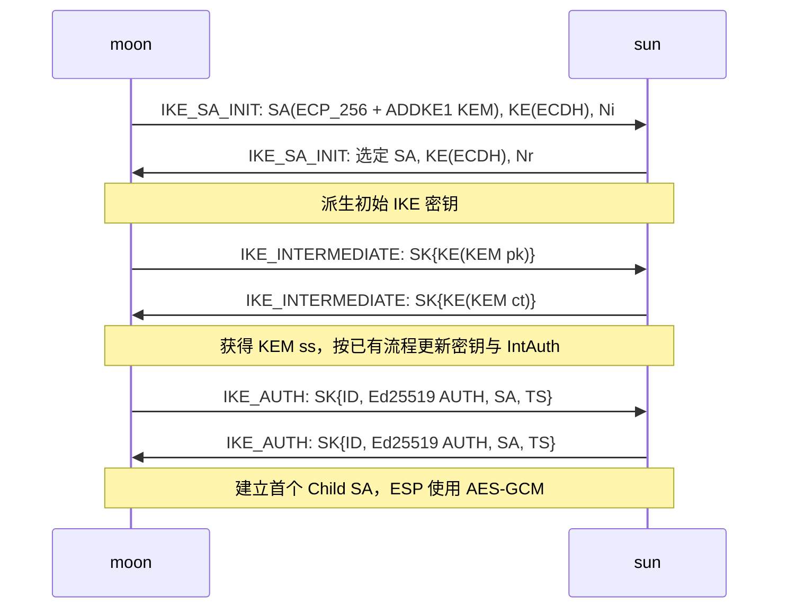

# Aigis-enc 混合密钥交换接入计划与 moon–sun ML-KEM 实验步骤

> 实施更新（2026-11-17）：用户已完成 ML-KEM 验证。Aigis-enc mode 2 / SM3 插件已在本地实现，PQMagic 源目录为 `/home/lxh/PQMagic`。本文保留设计依据，当前构建、测试和安装步骤见[构建与测试说明](pqmagic-aigis-build-and-test.md)，实际结果与限制见[实施记录](aigis-enc-implementation-progress.md)。系统安装与真实 moon/sun Aigis 通信尚未执行。

## 1. 本阶段目标与环境基线

更新日期：2026-11-17。本地源码为 strongSwan **6.1.0**，提交 `2436681d59852cc342ea81b40187c6f4eea15186`。环境安装记录见 [strongswan.md](strongswan.md)。

本阶段先完成两件事：

1. 用 strongSwan 已支持的 **传统 ECDH + ML-KEM** 跑通现有双机实验，建立可核验的混合密钥交换基线。
2. 参照 `ml` 插件接入模式，规划 **传统 ECDH + PQMagic Aigis-enc**：新增 KE 实现，复用协商、交换调度和密钥派生。

**认证继续使用原有 X.509/Ed25519 证书和私钥。Aigis-sig 的签名、OID、凭据编码和证书改造留到后续阶段。** 这里的“混合”指 ECDH 与 KEM 共同参与密钥建立；ESP 数据包继续由 AES-GCM 加密。

### 1.1 双机拓扑

| 项目               | moon（当前本地）                               | sun（对端）                                   |
| ------------------ | ---------------------------------------------- | --------------------------------------------- |
| 地址               | `192.168.199.131`                            | `192.168.199.130`                           |
| IKE 身份           | `C=CH, O=strongSwan, CN=moon.strongswan.org` | `C=CH, O=strongSwan, CN=sun.strongswan.org` |
| 证书               | `moonCert.pem`                               | `sunCert.pem`                               |
| 私钥               | `moonKey.pem`                                | `sunKey.pem`                                |
| IKE / Child 配置名 | `host-host` / `host-host`                  | `host-host` / `host-host`                 |
| 流量选择器         | 本机 `/32` → 对端 `/32`                   | 本机 `/32` → 对端 `/32`                  |

地址、身份及传统算法通信成功记录来自环境文档；其中已验证的主 KE 是 ECP_256。本文采用相同的 ECP_256，便于比较加入 KEM 前后的行为。

### 1.2 本次实际核查到的本地状态

| 检查项                           | 结果与含义                                                                                                                                                                  |
| -------------------------------- | --------------------------------------------------------------------------------------------------------------------------------------------------------------------------- |
| `config.log` 的 configure 命令 | `--prefix=/usr --sysconfdir=/etc --enable-systemd --enable-swanctl --enable-vici --enable-pki --enable-openssl --disable-charon --disable-stroke`，与环境文档一致         |
| `config.status`                | `USE_ML_TRUE="#"`、`USE_SHA3_TRUE="#"`：本次构建未启用 `ml` 和 `sha3`；`drbg` 已启用                                                                              |
| OpenSSL                          | 本地 `openssl version` 为 **3.0.13**                                                                                                                                |
| 安装目录                         | `/usr/lib/ipsec/plugins/` 下有 openssl、drbg 插件，未找到 ml、sha3 插件                                                                                                   |
| `/etc/strongswan.conf`         | `charon.load_modular = yes`，包含 `strongswan.d/charon/*.conf`                                                                                                          |
| 插件配置                         | openssl、drbg 的 `load = yes`；当前无 `ml.conf`、`sha3.conf`                                                                                                          |
| systemd 单元                     | `/usr/sbin/charon-systemd`；启动后执行 `/usr/sbin/swanctl --load-all --noprompt`                                                                                        |
| 当前连接文件与运行中的 SA        | `/etc/swanctl/swanctl.conf` 不可由当前用户直接读取，VICI 连接受限；提权后的 `sudo -n` 仍要求密码，故未取得实时 `--list-conns` / `--list-sas` / `--list-algs` 结果 |

**结论：不能只往现有 proposal 写入 `mlkem768` 就认为 ML-KEM 已可用；应先给两端构建并加载 `ml`。** 本地源码 `openssl_kem.c:23` 与 `openssl_plugin.c:531` 的普通 OpenSSL ML-KEM 分支要求 3.5.0+，因此不依赖现有 OpenSSL 3.0.13 直接提供 ML-KEM。采用原生 `ml` 插件不需要升级 OpenSSL。[官方 ML-KEM/OpenSSL 支持说明](https://www.strongswan.org/blog/2025/07/14/strongswan-6.0.2-released.html)

下面是供使用者在两台虚拟机终端执行的步骤。本次仅修改本文档，未重编译、安装、修改 `/etc`、重启服务或发起/中断连接。

## 2. 先使用现有 ML-KEM 进行通信

### 2.1 两端重新配置、编译和安装

在 **moon 和 sun 分别**执行。保留原有构建参数，新增 `--enable-ml --enable-sha3`：

```bash
cd ~/strongswan
./configure --prefix=/usr --sysconfdir=/etc \
  --enable-systemd --enable-swanctl --enable-vici \
  --enable-pki --enable-openssl \
  --enable-ml --enable-sha3 \
  --disable-charon --disable-stroke
make -j"$(nproc)"
sudo make install
sudo ldconfig
sudo systemctl daemon-reload
```

当前源码树已有 `configure`，仅启用现有插件不需要再运行 `autogen.sh`。这里 `--disable-charon` 禁用的是独立的 charon 可执行程序，不会禁用通过 `--enable-systemd` 构建的 charon-systemd 及其 libcharon。

`ml_plugin.c:43` 声明其依赖 SHA3-256/512、SHAKE128/256 和 RNG_STRONG。`sha3_plugin.c:42` 同时提供 SHA3 hasher 和 SHAKE XOF；OpenSSL 插件也可以提供这些基础能力，因此 **sha3 不是必须由同名插件提供的硬性绑定**。本实验显式启用 `sha3` 是为了获得清晰、独立的原生基线，继续保留 openssl 处理现有证书、ECDH 和对称密码。

安装后在两端检查：

```bash
ls /usr/lib/ipsec/plugins/libstrongswan-ml.so
ls /usr/lib/ipsec/plugins/libstrongswan-sha3.so
cat /etc/strongswan.d/charon/ml.conf
cat /etc/strongswan.d/charon/sha3.conf
```

正常安装会根据已启用插件生成并安装配置片段，内容应分别包含：

```text
# /etc/strongswan.d/charon/ml.conf
ml {
    load = yes
}
```

```text
# /etc/strongswan.d/charon/sha3.conf
sha3 {
    load = yes
}
```

若文件缺失或已有文件中 `load = no`，用 `sudo nano` 补齐/调整，再在后续步骤重启。该安装规则不会主动覆盖已有配置片段，见 [conf/Makefile.am](../conf/Makefile.am)。当前是模块化加载，所以要同时检查“库已安装”和“load 已开启”。

### 2.2 两端修改 host-host 提案

先分别备份，再编辑实际加载的文件：

```bash
sudo cp -a /etc/swanctl/swanctl.conf /etc/swanctl/swanctl.conf.pre-mlkem
sudo nano /etc/swanctl/swanctl.conf
```

在原有配置中增加/修改三个设置即可：

```text
# host-host 连接层，与 version 同级
fragmentation = yes
proposals = aes256gcm16-prfsha384-ecp256-ke1_mlkem768

# children.host-host 层，与 local_ts 同级
esp_proposals = aes256gcm16-ecp256-ke1_mlkem768
```

- `ecp256`：第一轮传统 ECDH，与已验证基线一致。
- `ke1_mlkem768`：第一轮附加交换，使用 ML-KEM-768；不是把两个算法名称并列为“二选一”。
- IKE 的 AES-GCM 提案显式写 `prfsha384`；无需另列完整性算法。
- ESP 仍用 AES-256-GCM；其提案中的 KE/ADDKE 用于后续独立 Child 创建或 rekey 的 PFS。
- 不加 `ke1_none`、`default` 或纯经典备选，以便验证所选配置确实要求附加 KEM。
- **ML-KEM 使用本地已有的方法编号 35/36/37，本实验不需要打开 `accept_private_algs`。**

`ke1_` 的含义和组合规则见 [strongSwan 算法提案说明](https://docs.strongswan.org/docs/latest/config/proposals.html#_key_exchange_methods)。

为避免放错配置层级，以下给出与环境记录一致的完整连接示例。如实际文件还有其他连接/设置，仅合并目标 `host-host`，不要把整个文件直接替换掉。

**moon：**

```text
connections {
    host-host {
        version = 2
        local_addrs = 192.168.199.131
        remote_addrs = 192.168.199.130
        fragmentation = yes
        proposals = aes256gcm16-prfsha384-ecp256-ke1_mlkem768

        local {
            auth = pubkey
            certs = moonCert.pem
            id = "C=CH, O=strongSwan, CN=moon.strongswan.org"
        }
        remote {
            auth = pubkey
            id = "C=CH, O=strongSwan, CN=sun.strongswan.org"
        }
        children {
            host-host {
                local_ts = 192.168.199.131/32
                remote_ts = 192.168.199.130/32
                esp_proposals = aes256gcm16-ecp256-ke1_mlkem768
                start_action = trap
            }
        }
    }
}
```

**sun：**

```text
connections {
    host-host {
        version = 2
        local_addrs = 192.168.199.130
        remote_addrs = 192.168.199.131
        fragmentation = yes
        proposals = aes256gcm16-prfsha384-ecp256-ke1_mlkem768

        local {
            auth = pubkey
            certs = sunCert.pem
            id = "C=CH, O=strongSwan, CN=sun.strongswan.org"
        }
        remote {
            auth = pubkey
            id = "C=CH, O=strongSwan, CN=moon.strongswan.org"
        }
        children {
            host-host {
                local_ts = 192.168.199.130/32
                remote_ts = 192.168.199.131/32
                esp_proposals = aes256gcm16-ecp256-ke1_mlkem768
                start_action = trap
            }
        }
    }
}
```

证书、CA 和私钥沿用已成功通信的那一套，无需为 KEM 重新签发证书。ML-KEM 的临时公私钥由交换对象生成，不放进 `swanctl/private/`。

### 2.3 重启并确认算法真正可用

编译、安装和编辑均完成后，**先 sun、后 moon**，在各自终端执行：

```bash
sudo systemctl restart strongswan
systemctl status strongswan -l --no-pager
sudo swanctl --list-algs
sudo swanctl --list-conns
sudo journalctl -u strongswan -n 100 -l --no-pager
```

这是插件变更，必须重启守护进程；仅 `--load-conns` 不会让运行中的旧进程自动加载新编译的插件。服务的 ExecStartPost 会执行 `--load-all`，不必额外重复加载。若以后只修改 proposal，两端运行 `--load-conns`，再终止并重新建立旧 IKE SA，使现有 SA 也切换到新配置。

确认：

1. 服务为 active，日志的 `loaded plugins` 包含 ml；没有 ml 的依赖加载失败。
2. `--list-algs` 的 `ke:` 部分包含 **ML_KEM_768**，本方案预期由 `[ml]` 提供；同时具备 ECP_256、AES_GCM_16、PRF_HMAC_SHA2_384。
3. `--list-conns` 有正确地址和身份的 `host-host`，没有 `loaded 0 of 1 connections`。

`--list-algs` 查询的是 daemon 的运行时能力，因此比“源码里有该算法”或“磁盘上有 so 文件”更能说明能否协商。

### 2.4 moon 发起，检查实际协商与流量

在 **moon** 执行：

```bash
sudo swanctl --initiate --child host-host
ping -I 192.168.199.131 -c 4 192.168.199.130
sudo swanctl --list-sas
sudo swanctl --list-sas --raw
sudo journalctl -u strongswan -n 150 -l --no-pager
```

在 **sun** 查看同一连接并测试反向流量：

```bash
ping -I 192.168.199.130 -c 4 192.168.199.131
sudo swanctl --list-sas
```

以下是**预期标志，并非本次已经取得的 ML-KEM 运行结果**：

- IKE SA 为 `ESTABLISHED`；其协商算法显示 ECP_256 以及 `KE1_ML_KEM_768`。
- `--raw` 的 IKE SA 段有 `dh-group=ECP_256`、`ake1=ML_KEM_768`；不要只在某个配置文本中搜索 `mlkem768`。
- 日志出现 IKE_INTERMEDIATE 的收发，随后 IKE_AUTH 成功。
- Child SA 为 `INSTALLED`，使用 `ESP:AES_GCM_16-256`，TS 为两台主机的 `/32`；反复 ping 后 in/out 包计数增长。

实际字段可对照本地 [rw-mlkem/evaltest.dat](../testing/tests/ikev2/rw-mlkem/evaltest.dat)；`list_sas.c:107` 会把附加交换格式化为 `/KE1_...`，`vici_query.c:290` 生成 raw 的 `ake1` 字段。

### 2.5 再验证 Child / IKE rekey

上面的完整配置从开始就给 IKE 和 Child 都加了必选 ML-KEM。建立成功后，在 **moon** 分别执行，等前一次完成再继续：

```bash
sudo swanctl --rekey --child host-host
sudo swanctl --list-sas
sudo swanctl --list-sas --raw
ping -I 192.168.199.131 -c 4 192.168.199.130
```

```bash
sudo swanctl --rekey --ike host-host
sudo swanctl --list-sas
sudo journalctl -u strongswan -n 150 -l --no-pager
```

`--rekey` 用法见 [官方命令说明](https://docs.strongswan.org/docs/latest/swanctl/swanctlRekey.html)。新旧 SA 短时间同时存在是可能的，要查看新 SA 完成后的状态。

**首个 Child SA 与 Child rekey 要分开理解：** 首个 Child 通常在 IKE_AUTH 中创建，没有自己的独立 KE，密钥来自已经混入 ML-KEM 秘密的 IKE SK_d。后续 Child rekey 才按 `esp_proposals` 执行 ECDH + ML-KEM，并使用 IKE_FOLLOWUP_KE 完成附加交换。不能因为首个 Child 的输出未显示独立 ML-KEM 就判定 IKE 混合交换失败，也不能仅靠初建成功证明 Child PFS 已验证。

如果先前只给 IKE 加了 KEM，现在才改 Child proposal，应在两端加载配置并重新建立 IKE SA 后再测 rekey，避免复用旧 SA 持有的 Child 配置对象。还应由 sun 主动 rekey 一次，覆盖当前交换发起方与初始 IKE 发起方不同的情形。

### 2.6 常见问题与回退

| 现象                                                          | 优先检查                                                                                         |
| ------------------------------------------------------------- | ------------------------------------------------------------------------------------------------ |
| `mlkem768` 无法解析                                         | 拼写应是 `mlkem768` / `ke1_mlkem768`；是否运行旧版本二进制；关键字解析与算法提供者是两层检查 |
| 名称能解析，但 `--list-algs` 没有 ML_KEM_768                | 两端是否安装并加载 ml，插件依赖是否满足；查 daemon 日志                                          |
| `NO_PROPOSAL_CHOSEN`                                        | 两端 IKE/ESP 提案是否一致，是否都有 ECP_256 与 ML_KEM_768；不要只改 moon                         |
| `AUTHENTICATION_FAILED` / `no matching peer config found` | 优先核对已成功基线的证书文件、完整 DN、地址与实际加载连接，不为此盲目重新生成 CA                 |
| 修改后仍显示纯经典算法                                        | 旧 SA 是否仍在运行；是否还存在允许纯经典协商的 proposal / 同地址匹配连接                         |
| `--load-conns` 成功，但首轮交换或 rekey 超时                | 检查对端日志、IKE_INTERMEDIATE / FOLLOWUP 支持、分片与 UDP 500/4500 网络路径                     |
| ping 成功但不清楚是否经过 IPsec                               | 检查 TS、INSTALLED 状态及 in/out 计数是否随 ping 增长                                            |

要恢复传统基线，在两端恢复本次备份并加载连接，再由 moon 终止并重建：

```bash
# 两端
sudo cp -a /etc/swanctl/swanctl.conf.pre-mlkem /etc/swanctl/swanctl.conf
sudo swanctl --load-conns
```

```bash
# moon；会中断当前 host-host 实验 SA
sudo swanctl --terminate --ike host-host
sudo swanctl --initiate --child host-host
```

## 3. ML-KEM 在源码中如何接入

这次沿用 codegraph 定位已知符号，再局部读取；未通篇阅读项目。查询 `ml_kem_create` 定位到 `ml_kem.c:992`，定点阅读 753–795、897–1030 等接口附近代码，并用关键字搜索核对注册、依赖和协议任务。Codegraph 索引为 fresh，但宏/函数指针和部分 parse_error 会限制引用覆盖；调用图空结果不作为“没有调用”的证明。

### 3.1 从配置到算法的路径

```text
proposals = ...-ecp256-ke1_mlkem768
  → proposal_keywords_static.txt: mlkem768 → ML_KEM_768
  → key_exchange.c: additional_key_exchange_parser()
      把 ke1_ 基础名映射为 ADDITIONAL_KEY_EXCHANGE_1
  → ike_init.c 协商主 KE 和附加 KE，驱动 IKE_INTERMEDIATE
  → keymat_v2.c:create_ke()
  → crypto_factory.c:create_ke()
  → ml_plugin.c 注册的 ml_kem_create(ML_KEM_768)
  → key_exchange_t 的 get/set_public_key() 与 get_shared_secret()
  → 原有 keymat 派生逻辑更新 IKE 密钥
  → 原有 IKE_AUTH / Child SA 安装与 ESP 数据面
```

| 关键代码                                                                                                             | ML-KEM 已有做法                                                        | Aigis-enc 应沿用的接口                                          |
| -------------------------------------------------------------------------------------------------------------------- | ---------------------------------------------------------------------- | --------------------------------------------------------------- |
| [ml_plugin.c:43](../src/libstrongswan/plugins/ml/ml_plugin.c)                                                         | `PLUGIN_REGISTER(KE, ml_kem_create)`，提供三个 ML_KEM 方法并声明依赖 | 新插件注册自己的构造器和方法                                    |
| [ml_kem.c:780](../src/libstrongswan/plugins/ml/ml_kem.c)                                                              | 响应方返回已生成的密文，发起方生成密钥对并发公钥                       | getter 根据当前角色返回 pk 或 ct                                |
| [ml_kem.c:909](../src/libstrongswan/plugins/ml/ml_kem.c)                                                              | 已有发起方私钥时按 ct_len 校验并解封装；否则按 pk_len 校验并封装       | 不同角色校验不同类型/长度的数据                                 |
| [ml_kem.c:897](../src/libstrongswan/plugins/ml/ml_kem.c)                                                              | 按 ML-KEM 的多项式编码规则额外验证公钥                                 | Aigis 使用自身规范/PQMagic 支持的校验，不能照搬 ML-KEM 编码检查 |
| [ml_kem.c:948、971](../src/libstrongswan/plugins/ml/ml_kem.c)                                                         | 共享秘密克隆输出；销毁时清理秘密、临时数据与依赖对象                   | 明确 chunk 所有权及失败清理                                     |
| [ml_kem.c:992](../src/libstrongswan/plugins/ml/ml_kem.c) 与 [ml_params.c](../src/libstrongswan/plugins/ml/ml_params.c) | 按方法选参数；构造公共接口及所需 HASHER/XOF                            | Aigis 使用固定参数表和 PQMagic 调用，不移植 ML-KEM 多项式实现   |
| [key_exchange.h:94](../src/libstrongswan/crypto/key_exchange.h)                                                       | 接口文档已经定义了 KEM 双方调用顺序                                    | 不新增另一种 KEM 工厂接口                                       |
| [key_exchange.c:500、621](../src/libstrongswan/crypto/key_exchange.c)                                                 | `ke1_`–`ke7_` 通用解析；`key_exchange_is_kem()` 标记方法        | 注册 Aigis 基础名并补分类                                       |
| [keymat_v2.c:87、239、536](../src/libcharon/sa/ikev2/keymat_v2.c)                                                     | KE 工厂委派、IKE 密钥和 Child 密钥派生                                 | 继续交给原有派生流程                                            |
| [ike_init.c:152、555、609、986](../src/libcharon/sa/ikev2/tasks/ike_init.c)                                           | 区分初建/重协商交换类型，收集方法，校验协商号与 KE payload，一致后派生 | 通常复用；围绕新算法做集成测试                                  |
| [child_create.c:1327、1629](../src/libcharon/sa/ikev2/tasks/child_create.c)                                           | 独立 Child 创建及附加交换已有实现                                      | 覆盖 Child rekey 与双端主动发起                                 |
| [ke_payload.c:142、247](../src/libcharon/encoding/payloads/ke_payload.c)                                              | payload 传递方法号和字节串；其 verify 本身不做算法输入校验             | 长度和算法检查必须由实现负责                                    |

### 3.2 混合交换的协议顺序



初建的额外交换放在 IKE_INTERMEDIATE；IKE rekey 和后续 Child 创建/重协商使用 CREATE_CHILD_SA + IKE_FOLLOWUP_KE，见 [RFC 9370](https://www.rfc-editor.org/rfc/rfc9370.html)。IKE_SA_INIT 不支持 RFC 7383 的 IKE 分片，IKE_INTERMEDIATE 可以使用协商后的分片机制，适合承载 KEM 的较大公钥和密文。[RFC 9242](https://www.rfc-editor.org/rfc/rfc9242.html#section-1)

KEM 插件仅提供 ss，**不要自己 XOR 两个秘密或把 KEM ss 直接当 AES 密钥**。现有 keymat 区分初建和更新；初建后的额外 KE 按已有 SK_d 更新，rekey 收集各 KE 后再派生，不能简化为所有阶段同用一个手写公式。[ike_auth.c:214](../src/libcharon/sa/ikev2/tasks/ike_auth.c) 的 IntAuth 收集继续由框架处理，保证中间交换最终被认证绑定。

## 4. 参照 ML-KEM 接入 PQMagic Aigis-enc

### 4.1 推荐边界

新增 `src/libstrongswan/plugins/pqmagic/`，链接独立构建的 PQMagic。只实现 KEM，继续使用已经成功的证书认证；不把 PQMagic 调用直接写进 `ike_init.c`，也不把 Aigis 冒充 ML_KEM_768 注册。

首版固定 **Aigis-enc mode 2、PQMagic-std、算法内部 SM3**，以减少组合数。这是原型参数选择，最终安全等级及参数选择由实验目标确定。本次锁定 PQMagic 提交 `42f5b6e6fe7e4951ffc9437ecd77c9a5af93ff08`；源代码位于外部目录 `/home/lxh/PQMagic`，未复制进入 strongSwan 源码树。

Aigis 插件只需让 KE 工厂认识新方法；已有握手、密钥派生、Ed25519 凭据和内核 XFRM 数据面继续沿用。临时 KEM 公钥通过 KE payload 传递，本阶段不涉及 X.509 公钥 OID 或 PKCS#8 凭据加载改造。

### 4.2 步骤 A：先独立验证 PQMagic

外部构建 PQMagic 并安装到实验专用前缀。根据固定版本的 CMake 使用 `ENABLE_AIGIS_ENC`、`AIGIS_ENC_MODES`、`USE_SM3` / `USE_SHAKE`；不需要为当前目标启用签名算法。当前官方 std 库规则形成 `libpqmagic_std.so/.a`，安装 `pqmagic_api.h`，实施时以固定提交的实际产物为准。[PQMagic 构建规则](https://github.com/pqcrypto-cn/PQMagic/blob/main/CMakeLists.txt)

普通接口的 mode 2 符号为：

```c
int pqmagic_aigis_enc_2_std_keypair(unsigned char *pk, unsigned char *sk);
int pqmagic_aigis_enc_2_std_enc(unsigned char *ct, unsigned char *ss,
                              const unsigned char *pk);
int pqmagic_aigis_enc_2_std_dec(unsigned char *ss, const unsigned char *ct,
                              const unsigned char *sk);
```

API 不带输入长度，所以必须在适配层先校验缓冲区。公钥、私钥、密文和共享秘密长度分别为 **896、2208、992、32 bytes**；实现使用固定版本头文件的常量/集中参数表。[Aigis-enc API](https://github.com/pqcrypto-cn/PQMagic/blob/main/kem/aigis-enc/std/api.h)、[参数定义](https://github.com/pqcrypto-cn/PQMagic/blob/main/kem/aigis-enc/std/params.h)、[符号命名](https://github.com/pqcrypto-cn/PQMagic/blob/main/kem/aigis-enc/std/config.h)

先独立运行 keypair→enc→dec，对比双方 ss，并运行依赖自带正确性/KAT 测试；成功后再进入 strongSwan 适配。参数 2 与 ML-KEM-768 的长度、编码、随机数契约不能混用。

### 4.3 步骤 B：添加方法号、名称和 proposal 关键字

| 修改点                              | 拟定内容                                                                |
| ----------------------------------- | ----------------------------------------------------------------------- |
| `crypto/key_exchange.h`           | 新增 `AIGIS_ENC_2_SM3`，实验编号暂约定 **65002**                |
| `crypto/key_exchange.c` 的名称表  | 长名 `AIGIS_ENC_2_SM3`，短名 `aigisenc2sm3`；正确链接 ENUM 各个范围 |
| `key_exchange_is_kem()`           | 新方法返回 TRUE；影响 crypto tester 的 KEM 测试路径                     |
| `key_exchange_check_pubkey_len()` | 明确新 KEM 的输入校验交给插件，不套用 DH 的单一公钥长度规则             |
| `proposal_keywords_static.txt`    | `aigisenc2sm3, KEY_EXCHANGE_METHOD, AIGIS_ENC_2_SM3, 0`               |

`ke1_aigisenc2sm3` 由现有附加 KE parser 生成，不必手写七套关键字。基础关键字不含 `-`，避免被 proposal 分隔符切开。更新输入后依据 [libstrongswan/Makefile.am:258–268](../src/libstrongswan/Makefile.am) 用 gperf 再生成关键字文件，不仅修改生成的 `.c`。

65002 是双端封闭实验的拟用私有值，需确认实验内无冲突；**不是 Aigis 的 IANA 标准编号**。IANA 为 KE 私有使用保留 1024–65535，主 KE 与 ADDKE 共享同一方法表；不得借用 ML-KEM 的编号。[IANA KE 表](https://www.iana.org/assignments/ikev2-parameters/ikev2-parameters.xhtml#ikev2-parameters-8)

### 4.4 步骤 C：实现 key_exchange_t 适配器

新增 `pqmagic_kem.[ch]`，对外构造函数：

```c
key_exchange_t *pqmagic_kem_create(key_exchange_method_t method);
```

对象保存参数表、角色/状态、临时 pk/sk、响应方 ct 和 ss。方法与 ML-KEM 对照如下：

| 调用                              | Aigis-enc 实现动作                   | 必须检查                                             |
| --------------------------------- | ------------------------------------ | ---------------------------------------------------- |
| 发起方首次 `get_public_key()`   | 调 keypair，保存 pk/sk，返回 pk 副本 | 缓存当前交换的密钥对；不因 getter 重复调用切换密钥   |
| 响应方首次 `set_public_key(pk)` | 校验输入，调 enc，保存 ct/ss         | mode 2 的 pk 必须为 896 bytes；按 Aigis 格式要求校验 |
| 响应方 `get_public_key()`       | 返回缓存 ct 副本                     | ct 为 992 bytes；重复导出不重新封装                  |
| 发起方 `set_public_key(ct)`     | 校验后调 dec，保存 ss                | 必须已有本次 sk；ct 为 992 bytes                     |
| `get_shared_secret()`           | 完成后返回 32-byte ss 的克隆         | 未完成/失败时不暴露半成品                            |
| `get_method()`                  | 返回 AIGIS_ENC_2_SM3                 | 与协商号及发出 payload 一致                          |
| `destroy()`                     | 擦除 sk/ss/秘密临时量，释放对象      | 遵守 chunk 所有权，失败路径同样清理                  |

不要拷贝 `ml_kem.c` 的多项式数学实现；只参照接口契约、角色识别、返回值和资源管理模式。getter 缓存是新适配器的设计要求，不应机械照抄生成密钥的细节。对重复 setter 约定幂等或拒绝，避免已发出的 ct 和内部 ss 不一致。

**隐式拒绝：** 所查 PQMagic `dec()` 对等长无效密文会生成替代秘密并返回 0；不能靠返回 0 判定密文可信，也不应破坏该机制。错误长度提前拒绝；等长篡改导致双方秘密不一致，后续协议完整性/认证失败，不能建立认证成功的 SA。[Aigis-enc kem.c](https://github.com/pqcrypto-cn/PQMagic/blob/main/kem/aigis-enc/std/kem.c)

### 4.5 步骤 D：注册插件并接入构建

新增 `pqmagic_plugin.[ch]`，核心特性示意：

```c
PLUGIN_REGISTER(KE, pqmagic_kem_create),
    PLUGIN_PROVIDE(KE, AIGIS_ENC_2_SM3),
```

参考 `ml_plugin.c` 的注册形态，但**依赖按实际实现声明**：若 PQMagic 内部提供 SM3、随机数，不应照抄 ML-KEM 的 SHA3/SHAKE 依赖；若适配层使用 strongSwan RNG，再声明 RNG_STRONG 依赖。

构建改动：

1. `configure.ac`：`--enable-pqmagic`、`PQMAGIC_CFLAGS` / `PQMAGIC_LIBS`，检测头文件与三个实际导出符号；增加 ADD_PLUGIN、USE_PQMAGIC 条件及 Makefile 输出。
2. `src/libstrongswan/Makefile.am`：增加插件子目录及 MONOLITHIC 链接，仿照 ml 的 USE_ML 分支。
3. `plugins/pqmagic/Makefile.am`：列出插件和 KEM 适配器，局部使用依赖 flags。只有多参数扩展确有需要时再拆参数文件。
4. 插件装载目标先仿照 `ADD_PLUGIN([ml], [s charon scripts nm cmd])`，保证当前 charon-systemd 路径可用。`swanctl --list-algs` 通过 VICI 查询 daemon，不要求 swanctl 自己加载 KEM 插件。
5. 当前仅接入 KEM，无须为 pki 或凭据加载工具添加 Aigis 签名支持。按安装配置机制生成 `pqmagic.conf` 并设 `load = yes`。

后续真正修改 Autotools 输入后，再运行 autogen/configure/make。插件关闭时应可照常构建；开启但 PQMagic 不存在时 configure 应明确失败。

随机数先核查固定 PQMagic 的生产 RNG 路径及线程安全。已检查的 `randombytes.c` 在部分错误上会 abort，普通 API 返回码不足以表达全部失败；若实验要求可恢复错误处理，须专门适配。测试使用该版本 coins/internal 入口及对象级测试 seed，不通过全局替换 randombytes 注入确定性随机数。[PQMagic 随机数实现](https://github.com/pqcrypto-cn/PQMagic/blob/main/utils/randombytes.c)

### 4.6 步骤 E：在同一 moon–sun 拓扑替换附加 KE

**此步骤必须等两端安装插件且 `--list-algs` 出现 AIGIS_ENC_2_SM3 后执行。** 当前源码已实现 Aigis 关键字与插件；系统服务的原有安装不因源码编译而自动更新。保留第 2 节的地址、身份、证书、TS 与 ECP_256，只在两端将两行替换为：

```text
proposals = aes256gcm16-prfsha384-ecp256-ke1_aigisenc2sm3
esp_proposals = aes256gcm16-ecp256-ke1_aigisenc2sm3
```

由于采用私有编号，实验两端还要在 `/etc/strongswan.conf` 已有 `charon` 节中加入：

```text
charon {
    accept_private_algs = yes
}
```

这里是合并设置，不删除原有 `load_modular` 和 plugins include。`ike_init.c:500` 与 `child_create.c:905` 在未识别 strongSwan 对端扩展且未开启该选项时会设置 PROPOSAL_SKIP_PRIVATE；显式启用可避免私有方法在测试中被过滤。该设置与 ML-KEM 基线分开，ML-KEM 通信无需它。

安装新插件及修改 daemon 设置后重启两端，再按第 2 节发起、ping、观察协商和 rekey。预期 IKE raw 中显示 `dh-group=ECP_256`、`ake1=AIGIS_ENC_2_SM3`，认证仍是原来的证书签名。

## 5. 计划修改的文件与验证顺序

下表为接入涉及的文件；当前实现已新增/修改这些位置，验证证据及尚未执行的网络测试见[实施记录](aigis-enc-implementation-progress.md)。另外增加了 `libcharon/tests` 的真实 KEM 协议测试与独立依赖构建脚本。

| 文件                                                                                             | 职责                                                      |
| ------------------------------------------------------------------------------------------------ | --------------------------------------------------------- |
| 新增 `src/libstrongswan/plugins/pqmagic/pqmagic_plugin.[ch]`                                   | KE 能力注册与插件生命周期                                 |
| 新增 `src/libstrongswan/plugins/pqmagic/pqmagic_kem.[ch]`                                      | PQMagic API → key_exchange_t，集中保存 mode 2 参数和状态 |
| 新增该插件的 `Makefile.am`                                                                     | 外部库局部链接和插件构建                                  |
| 修改 `configure.ac`、`src/libstrongswan/Makefile.am`                                         | 构建选项、依赖检测、目录、装载列表                        |
| 修改 `crypto/key_exchange.[ch]`、`crypto/proposal/proposal_keywords_static.txt`              | 方法号、名称、KEM 分类与关键字                            |
| 新增 `tests/suites/test_pqmagic_kem.c`，登记 `tests/tests.h`、`tests/Makefile.am`          | KEM 状态、长度、资源和异常测试                            |
| 扩展 `tests/suites/test_proposal.c`                                                            | 基础名/ke1_ 解析，必选/不兼容附加 KE 的选择               |
| 新增 `plugins/test_vectors/test_vectors/aigis_enc.c`，登记 `test_vectors.h`、`Makefile.am` | KAT，仿照已有 ml_kem 向量的注册方式                       |
| 新增 `testing/tests/ikev2/host2host-aigisenc/`                                                 | 双端证书认证与混合交换的完整网络测试                      |

**本阶段默认无需改动** AUTH/签名方案、密钥凭据编码、X.509、公私钥 OID、kernel-netlink 或 ESP 算法表；`ike_init.c`、`child_create.c`、`keymat_v2.c` 优先复用，只有测试发现具体不兼容时再做局部修改。

验证应按以下顺序推进，每步独立保留结果：

- [ ] **ML-KEM 基线**：第 2 节的初建、双向流量、IKE rekey、Child rekey 均成功，确认实际 ML_KEM_768，而非默认经典算法。
- [ ] **PQMagic 独立正确性**：固定提交与 SM3/mode 2，keypair→enc→dec 的 ss 一致，依赖 KAT 通过。
- [ ] **算法对象**：使用与 `key_exchange.h` 相同的双方调用顺序；长度错误、错误参数集、重复调用、未完成读取秘密均受控；同长无效 ct 不建立认证成功的 SA。
- [ ] **确定性测试**：当前本地启用 TESTABLE_KE，按固定版本 coins 契约实现 set_seed，测试向量注册后确实执行，不把依赖缺失导致的跳过当成功。
- [ ] **协商**：新关键字解析、私有方法号、插件缺失、对端仅支持经典方法、必选附加 KE 不匹配时的失败行为正确。
- [ ] **网络与生命周期**：IKE_INTERMEDIATE、Child/IKE 的 FOLLOWUP_KE、分片、丢包重传、双端主动 rekey、并发连接与清理。
- [ ] **回归**：ML-KEM 和原有传统算法仍正常；关闭 pqmagic 后可恢复第 2 节基线。

后续实现完成且测试环境配置齐备后，可使用现有单元测试入口 `make -C src/libstrongswan/tests check`，网络测试按 `testing/README` 准备后运行新用例。验收保留实际协商字段、日志、SA 变化和流量计数；共享秘密仅在隔离测试内比较，不在运行日志中输出私钥或会话密钥。

**当前交付边界：** ML-KEM 基线已由用户确认；Aigis-enc 已实现并进行本地构建/测试。源码修改不等于两端系统已部署或真实 ESP 通信已通过，具体状态见实施记录。Ed25519 身份认证继续保留，因此该阶段验证的是混合密钥建立，并非后量子签名认证。
